<picture>
  <source media="(prefers-color-scheme: dark)" srcset="./assets/source-dark.svg" />
  
</picture>

I build AI systems that ship to production and stay there. My work spans RAG architectures handling **50M+ documents**, multi-tenant LLM platforms serving **1M+ daily requests**, and semantic ranking models that improved click-through by **9%**. I've migrated **12 legacy ML workloads** to AWS, cut infrastructure costs by **35%**, and reduced deployment cycles from **10 days to 2**. Currently pursuing my M.S. in Computer Science at University at Buffalo while architecting enterprise AI infrastructure at C3 AI.

```ts
const vishnu: Engineer = {
  name: "Vishnu Krishnakumar Menon",
  role: "AI/ML Engineer",
  company: "C3 AI",
  location: "Buffalo, NY",
  yearsShipping: 5,
  languages: ["Python", "PySpark", "Pandas", "NumPy", "Scikit-learn", "PyTorch"],
  stack: ["Hugging Face Transformers", "LangChain", "LangGraph", "XGBoost", "Random Forest", "BERT", "QLoRA", "DPO"],
  focus: "Multi-tenant LLM platforms, AI orchestration, and model evaluation",
  career: [
    { at: "C3 AI", role: "AI/ML Engineer", when: "Aug 2025 – Present" },
    { at: "Glean", role: "AI/ML Engineer", when: "Jan 2023 – Jul 2024" },
    { at: "Accenture", role: "Data Scientist", when: "Aug 2021 – Dec 2022" },
    { at: "Accenture", role: "Associate Data Scientist", when: "Jan 2021 – Jul 2021" },
  ],
  education: "M.S. in Computer Science and Engineering, University at Buffalo, SUNY",
};
```

## `projects.map(explain)`

<details>
<summary><code>projects.ledger()</code> Self-verifying RAG for federal budget and energy reports</summary>

Decomposes generated answers into atomic factual claims, verifies each against retrieved source evidence using a local 7–8B model, and rewrites unsupported statements. Diagnosed a Docling table-parsing defect affecting **5.5%** of table cells and implemented PDF text-layer reconstruction, raising held-out table-cell accuracy from **30.5% to 100%**. Integrated distributed tracing with OpenTelemetry and Arize Phoenix on AWS EC2, alongside a crash-safe Batch API evaluation runner and **223 automated tests** in GitHub Actions CI.

</details>

<details>
<summary><code>projects.theraMind()</code> Dual-mode clinical LLM agent fine-tuned from Llama 3.2-3B</summary>

Built and deployed a clinical agent fine-tuned using QLoRA and DPO on **9,250 clinical dialogues**, improving ROUGE-L from **0.40 to 0.78** with a **19.5-minute** training runtime on RTX 4090. Developed a ChromaDB-based RAG architecture supporting clinical intake and note-generation workflows, combining retrieval-grounded responses, safety prompts, and constrained decoding. Applied Direct Preference Optimization with **49 preference pairs** to refine response alignment.

</details>

<details>
<summary><code>projects.driftguardLlm()</code> Catch silent RAG/LLM quality regressions before users do</summary>

Automated model evaluation and drift-monitoring workflows using MLflow, Prometheus, and Grafana, integrating regression checks into CI/CD. Built with FastAPI, pgvector, Qdrant, LlamaIndex, LangChain, and Evidently AI. Deployed via Docker with GitHub Actions for continuous monitoring.

</details>

<details>
<summary><code>projects.agentopsSentinel()</code> Supervisor/critique agent framework for support-ticket triage</summary>

A LangGraph-based multi-agent system with supervisor and critique agents, fully traced with OpenTelemetry. Reliable, cost-bounded ticket triage using FastAPI, Redis, and Docker. Includes pytest test coverage and integrates Anthropic and OpenAI APIs.

</details>

<details>
<summary><code>projects.agentgate()</code> Safely expose internal APIs to LLM agents</summary>

Per-agent auth, scoped permissions, spend/rate limits, and full audit logs for agentic AI adoption. Built with FastAPI, Pydantic, PostgreSQL, Redis, and OpenTelemetry. Deployed via Docker with comprehensive API gateway controls.

</details>

<details>
<summary><code>projects.fraudDetectionSystem()</code> ML-powered fraud detection for e-commerce</summary>

Protecting **$20B+** in annual transactions through real-time fraud detection. Full-stack implementation with TypeScript frontend, Python ML backend, and Docker deployment. Includes CSS, HTML, and JavaScript UI components.

</details>

## `CHANGELOG.md`

### v4.0 · C3 AI

*Aug 2025 – Present*

- **Architected** a multi-tenant LLM and RAG inference platform supporting **20+ enterprise deployments** and **1M+ daily requests**, maintaining **99.9% uptime** through separated retrieval, orchestration, and model-serving services on Kubernetes
- **Shipped** LangGraph-based AI orchestration workflows integrating document analysis, retrieval, LLM inference, and response verification with automated validation gates and fault isolation
- **Improved** infrastructure costs by **35%** and deployment cycles from **10 days to 2** by migrating **12 legacy ML workloads** to AWS with Docker and Terraform
- **Added** automated model evaluation and drift-monitoring workflows using MLflow, Prometheus, and Grafana, detecting model regressions **4x faster** and reducing production incidents by **40%**

### v3.0 · Glean

*Jan 2023 – Jul 2024*

- **Improved** transformer-based semantic ranking models through hard-negative mining and embedding fine-tuning, raising offline top-3 relevance by **18%** on NDCG and online click-through rates by **9%**
- **Shipped** reusable Apache Airflow pipelines and standardized feature management, reducing training and evaluation turnaround from **5 days to 1.5 days**
- **Improved** search inference performance through INT8 quantization, request batching, and embedding caching, reducing p95 query latency by **40%**, from **820 ms to 490 ms**

### v2.0 · Accenture

*Aug 2021 – Dec 2022*

- **Shipped** a retail demand-forecasting model using XGBoost and Prophet ensembles with **60+ predictive features**, improving forecast accuracy by reducing MAPE from **18% to 14%**
- **Added** an NLP-based service ticket classifier integrated with the client's operational platform using FastAPI and Docker on Azure, automating **70%** of ticket routing and saving approximately **1,200 agent hours quarterly**
- **Improved** operational reporting for **5 business units** using Python, SQL, and Airflow pipelines, replacing manual Excel processes and saving **25 analyst hours per week**

### v1.0 · Accenture

*Jan 2021 – Jul 2021*

- **Shipped** a hybrid recommendation system combining collaborative and content-based filtering, achieving a **12%** increase in click-through rates during A/B testing
- **Added** Random Forest and XGBoost churn prediction models with **40+ candidate features** and cross-validated hyperparameter tuning, achieving an AUC of **0.86**
- **Improved** document classification through a BERT-based pilot on **10K labeled records**, achieving a **91% F1 score** with SpaCy and NLTK preprocessing

## `npm ls --depth=0`

<p align="center">
  
</p>

## `contact()`

[`email`](mailto:vishnumenon@myworkgmail.com) · [`linkedin`](http://www.linkedin.com/in/vkm47) · [`website`](https://vkm47-theramind-ai.hf.space/) · [`github`](https://github.com/Vishnu-K-Menon)

## Projects

- [driftguard-llm](https://github.com/Vishnu-K-Menon/driftguard-llm) — Catch silent RAG/LLM quality regressions before your users do.
- [agentops-sentinel](https://github.com/Vishnu-K-Menon/agentops-sentinel) — A supervisor/critique agent framework for support-ticket triage, reliable, cost-bounded, and fully traced.
- [advanced-rag-llm-app](https://github.com/Vishnu-K-Menon/advanced-rag-llm-app) — This project is a self-contained summer-internship-level implementation of an advanced AI application that combines Retrieval-Augmented Generation (RAG)…
- [agentgate](https://github.com/Vishnu-K-Menon/agentgate) — Companies adopting agentic AI need to safely expose internal APIs to LLM agents with per-agent auth, scoped permissions, spend/rate limits, and full audit logs…
- [fraud-detection-system](https://github.com/Vishnu-K-Menon/fraud-detection-system) — Protecting $20B+ in annual e-commerce transactions with ML-powered fraud detection
- [sentinel-triage](https://github.com/Vishnu-K-Menon/sentinel-triage) — Cut mean-time-to-triage without teaching your SOC to cry wolf.
